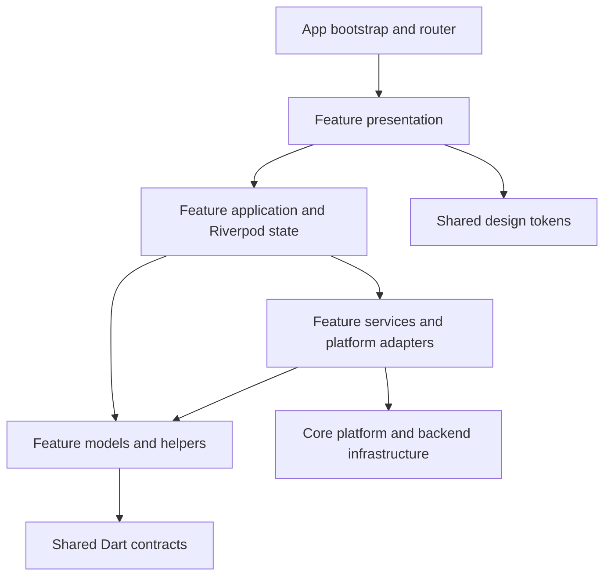

# Architecture and ownership

Updated 2026-09-05. This map describes the implemented structure.

## Application boundaries

The root is one Flutter application, `mobi_app`, with Android, iOS, and web hosts.
The admin experience shares its router and infrastructure. `landing/` is the
static website. `apps/momobio_sms_bridge/` is a separate Android operator utility
with its own build definition. No placeholder mobile, PWA, admin, agent, or venue
packages are maintained.

`lib/main.dart` delegates to `app/bootstrap.dart`. The root widget lives in
`app/app.dart`, navigation chrome in `app/shell.dart`, and routing in `app/router/`.
Runtime composition remains Riverpod.

## Dependency direction

Core must not import the app, shared app widgets, or features. Feature data must
not import application state or presentation. Domain code contains no Flutter,
Supabase, or platform-plugin dependencies. Shared packages never import the app.
The structure checker enforces these rules and resolves local import targets.

Existing platform-facing services can use platform SDK types. The NFC tag codec
belongs in BioPay data; shared payment payload parsing belongs in BioPay domain,
where both NFC adapters and views can consume it.

## Feature ownership

| Owner | Responsibilities |
| --- | --- |
| `admin` | Admin OTP, dashboard, users, moderation, operations, audit and broadcast services |
| `auth` | Passenger/driver WhatsApp login and its provider |
| `biopay` | Existing USSD request/face/NFC services, payloads and views |
| `bookings` | Scheduled trip posts, transport catalog, schedule state and views |
| `chat` | Conversation/message contracts, chat service and presentation |
| `ev_chargers` | Charger catalog model, service and locator views |
| `home` | Discovery entry presentation |
| `nearby` | Nearby discovery and driver location sharing |
| `notifications` | Consent, notifications, push integration and inbox |
| `profile` | Profiles, saved addresses, referrals and existing subscription/wallet surfaces |

Core owns Supabase construction, session/integrity helpers, Firebase
infrastructure, location/places, permissions, country configuration, errors and
utilities. `shared/` contains app-specific reuse; it is not a standalone package.

Features own their service providers in `application/`. Consumers import the
providers they use. Provider identities, constructor dependencies, and lazy
initialization semantics are preserved by the consolidation.

## Shared packages

- `mobi_design_system`: `package:mobi_design_system/theme/...` or its public barrel.
- `mobi_shared_types`: `package:mobi_shared_types/models/...` or its public barrel.
- `lucide_icons`: the existing compatibility fork with its original licence.

Redundant app-level theme/model exports are removed. Package `lib/src/`
implementations retain public `lib/theme/` and `lib/models/` exports. Shared
model parts are generated inside `packages/shared-types`.

## Build and evidence ownership

`.flutter-version` pins all Flutter GitHub Actions jobs. `scripts/lib/flutter.sh`
selects one Flutter/Dart installation; `runtime_defines.py` is the public
configuration parser shared by Android, iOS, PWA and profiling scripts. Its iOS
mode adds only the required platform App ID and optional public iOS overrides.

`bootstrap_flutter.sh` prepares a clean checkout, including generated models.
`verify_flutter.sh` runs architecture and helper checks before analysis and tests.
`verify_local.sh` adds local backend verification and optional platform builds,
without linked database credentials, deployment, or store uploads.
`check_repository_structure.py` rejects dangling imports, placeholder packages,
dependency inversions, tracked test output and mismatched CI Flutter versions.

Reviewed golden baselines, native platform sources, migration history, and
curated release evidence remain versioned. Historical bridge QA is consolidated
under `docs/release/evidence/momobio-sms-bridge/`; new captures go under `build/qa/`.

## Product compatibility

This refactor preserves implemented product and server contracts. The limited
marketplace scope was expanded by dated documents, including
`docs/product/biopay_ussd_aws_reactivation_scope_2026-06-12.md`. Older architecture
snapshots are not current product specifications. No payment execution, dispatch,
route computation, permissions or production activation is added by this refactor.

Historical plans are in `history/` and are not maps of current source paths.
Validation outcomes and recovery locations are in [the refactor report](refactor-20260905.md).
